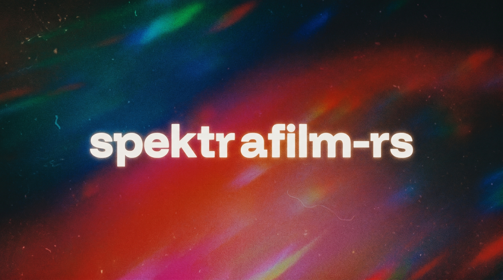

# spektrafilm-rs



A separately maintained film engine for **FPW**, based on the Rust port by
[turbasvin/spektrafilm-rs](https://github.com/turbasvin/spektrafilm-rs) of
[Andrea Volpato's spektrafilm](https://github.com/andreavolpato/spektrafilm).
It simulates analogue colour film and the print-and-scan chain.

FPW is the primary integration and acceptance target. This repository owns the
film/print/scanner algorithms, physical grain, GPU execution and engine caches;
FPW owns RAW preparation, recipes, masks, application scheduling, undo, UI and
file delivery. Engine changes are developed here and adopted by FPW through a
reviewed revision pin and matching resource identity. Standalone CLI and GUI
builds remain available without the FPW repository or a signed-in service.

FPW's production dependency is still its accepted vendor revision. Public RS
builds and synthetic tests do not by themselves authorize changing that pin.
The [host contract](docs/maintenance/HOST_GPU_INTEGRATION_CONTRACT.md),
[FPW integration plan](docs/maintenance/FPW_PARITY_MIGRATION_PLAN.md) and
[public host example](crates/spektrafilm-core/examples/fpw_host_contract.rs)
describe implemented interfaces and remaining acceptance work. Wide-gamut
working-space changes remain separate research.

Numerical compatibility is qualified per route, precision, input and device.
The historical Python comparison below is not a blanket claim of bit-identical
output for stochastic effects, the current GPU backend, or every FPW route.

---

## What it does

- **Spectral pipeline.** Hanatos2025 RGB→raw spectral upsampling, full 81-wavelength film/print/scanner spectral integration, density-curve interpolation, halation, DIR couplers, grain (bit-exact numpy `MT19937` port), glare, output CCTF encoding.
- **GPU film processing** on the pinned wgpu 30 Vulkan backend, including source-anchored multilayer grain, precise IIR, bounded work-plane/density reuse and scoped same-device output. Frame time depends on image size, effects, cache state and hardware; no current 60 fps guarantee is made.
- **f64 CPU reference/export** and f32 GPU paths, with explicit numerical comparisons and different precision contracts.
- **Decoupled preview + export.** GUI uses f32 GPU for iteration, then shells out to the f64 CPU binary for the final write. The export runs in a worker thread with a cancel button and proper child-process lifecycle.
- **Profiles bundled.** 30+ film and paper profiles in `data/profiles/` — Kodak Gold/Portra/Ektar, Fuji Velvia/Provia, Kodak Endura papers, Fuji Crystal Archive papers.

## Build

Requires Rust **1.99 or newer** (edition 2024), the standard system toolchain,
and Vulkan support for the current GPU backend. The lockfile pins wgpu 30.0.1
and eframe/egui 0.37.0. The current GPU configuration enables Vulkan, not Metal;
the historical upstream macOS measurements below do not establish support for
this fork's current GPU build.

```bash
git clone https://github.com/ye602a/spektrafilm-rs.git
cd spektrafilm-rs

# GUI (wgpu/Vulkan preview, eframe)
cargo build --locked --release -p spektrafilm-gui

# f32 CLI — fast batch processor, defaults to GPU backend
cargo build --locked --release -p spektrafilm-cli

# f32 CLI with experimental native CUDA backend option
cargo build --release -p spektrafilm-cli --features spektrafilm-gpu/cuda-backend

# f64 CLI — reference precision (CPU only; WGSL has no f64)
cargo build --release --features precision-f64 -p spektrafilm-cli
cp target/release/spektrafilm target/release/spektrafilm-f64

# Helper used by the GUI's Export button — bit-identical RAW decode
cargo build --release -p spektrafilm-cli --bin decode_raw_gui
```

The GUI auto-detects the f64 binary via `$SPEKTRAFILM_F64_CLI`, then `spektrafilm-f64` on `PATH`, then next to its own executable, then `target/release/spektrafilm-f64`.

Windows builds use the WGSL/wgpu backend by default. The CPU fallback path avoids requiring a system OpenBLAS install on Windows, while macOS and Unix-like targets still use native BLAS providers.

WGSL is the default GPU backend and can be selected explicitly with `SPEKTRAFILM_BACKEND=wgpu`. An experimental native CUDA backend can be built with `--features spektrafilm-gpu/cuda-backend` and selected with `SPEKTRAFILM_BACKEND=cuda`. It uses CUDA 12 driver/NVRTC bindings through dynamic loading, so the NVIDIA driver and NVRTC runtime DLLs must be available. Set `SPEKTRAFILM_CUDA_DEVICE=1` (or another zero-based index) to pick a non-default CUDA device. Both GPU paths have a resident preview implementation: front pass, highlight boost, camera diffusion, camera lens blur, halation, DIR couplers, grain, density curves, enlarger diffusion, print/scan spectral reductions, glare, output gamut compression, scanner lens blur, unsharp, and one readback.

## Usage

### GUI

```bash
./target/release/spektrafilm-gui [optional/path/to/image.orf]
```

- **Open…** — load a TIFF, PNG, or camera RAW (DNG/CR2/CR3/NEF/ARW/ORF/RW2/etc., decoded via [`rawler`](https://github.com/dnglab/dnglab)).
- **Sliders** — exposure, film format, halation, DIR couplers, grain, glare, scanner, enlarger, output. All live-updating against the GPU preview.
- **Profiles** — film stock and print paper combo boxes; picking a film auto-selects its paired paper (`target_print` in the profile).
- **Zoom** — scroll wheel or trackpad pinch over the preview (cursor-anchored), click-drag to pan, double-click to reset.
- **Export…** — re-runs the pipeline at f64 precision on the CPU and writes a PNG/TIFF/JPEG. Status bar shows elapsed time; **Cancel** kills the child cleanly. Closing the GUI mid-export also kills the child (no orphans).
- **Save…** — write the f32 GPU preview directly (instant, less precise).

### CLI

```bash
# f32 GPU (fast)
./target/release/spektrafilm process input.ORF -o out.png \
    --film kodak_gold_200 --paper kodak_portra_endura --data-dir data

# f32 native CUDA, when built with spektrafilm-gpu/cuda-backend
SPEKTRAFILM_BACKEND=cuda \
    ./target/release/spektrafilm process input.ORF -o out.png \
    --film kodak_gold_200 --paper kodak_portra_endura --data-dir data

# f64 CPU (reference)
SPEKTRAFILM_BACKEND=cpu \
    ./target/release/spektrafilm-f64 process input.ORF -o out.png \
    --film kodak_gold_200 --paper kodak_portra_endura --data-dir data

# Override any params via JSON (matches RuntimeParams struct)
... --params my_params.json

# List available film + paper profiles
./target/release/spektrafilm list-profiles --data-dir data
```

## Validation and historical Python comparison

Current validation runs in `.github/workflows/standalone-engine-smoke.yml`:
Windows builds the independent applications/API and CPU contracts; Linux uses
required software Vulkan to execute physical-chain, ownership, source-coordinate,
IIR, density-cache and output tests. GPU absence is a failure in that Linux job.
Dedicated hardware, frozen FPW photos and real host interaction/recovery remain
separate gates. The actual completed migration checks are recorded in
[GPU_MIGRATION_VALIDATION_20261113.md](docs/maintenance/GPU_MIGRATION_VALIDATION_20261113.md)
and the [FPW coupling record](docs/maintenance/FPW_ENGINE_COUPLING_20261113.md).

The upstream Rust port reported the following comparison with Python
`spektrafilm` v0.3.2 on the bare chain (no stochastic FX). These are retained
historical results, not a new measurement of this fork:

| Stage | Max diff | Mean diff | Identical pixels |
|---|---|---|---|
| `log_raw` (post-Hanatos + log10) | **8.9 × 10⁻¹⁵** (one f64 ULP) | 3.4 × 10⁻¹⁶ | — |
| Film density CMY | **1.1 × 10⁻¹⁵** | 1.7 × 10⁻¹⁶ | — |
| Print density CMY | **3.1 × 10⁻¹⁵** | 3.0 × 10⁻¹⁶ | — |
| Final PNG (8-bit) | **1 / 255** | 0.00004 / 255 | **99.9962 %** |

With grain on, the binomial sampler's rejection step is sensitive to upstream ULP shifts and the rendered grain texture diverges per pixel — this is by design (matches numpy's behaviour) and produces the same average tone with a different grain pattern.

The LUT path (`use_enlarger_lut` + `use_scanner_lut`, the typical export config) uses a bit-exact port of Python's PCHIP 3D interpolation (`crates/spektrafilm-math/src/pchip3d.rs` ↔ `spektrafilm/utils/fast_interp_lut.py`). Parity numbers above hold for both the LUT and non-LUT paths.

## Historical upstream performance

The following CPU and Apple Silicon numbers are retained from the upstream Rust
port. They have not been reproduced for this fork's current Windows/Vulkan FPW
integration. Cache reuse alone does not establish a measured speedup; compare
matching inputs, effects, hardware and cold/warm state before making one.

f64 CPU export on a 16 MP Olympus ORF (kodak_gold_200 → kodak_portra_endura, full FX):

| | Wall time | Notes |
|---|---|---|
| Python reference (numpy + numba) | 22 s | LUT enabled, default config |
| **spektrafilm-rs (f64 CPU)** | **14 s** | **35 % faster than Python** |

What gets it there:

- **PCHIP LUTs** for the spectral integrations (enlarger + scanner) — same approximation Python uses, same accuracy budget.
- **`vForce vvpow`** for `10^x` on the spectral chain — Accelerate's SIMD pow, bit-identical to libm `pow(10, x)`.
- **Accelerate BLAS dgemm** for the spectral reductions — a single `cblas_dgemm` per contraction, parallelised internally by Accelerate. (It is not safe to call concurrently from multiple threads, so the matmul is never split across rayon.)
- **Parallelised hot per-pixel loops** in the printing and scanning post-stages.

GPU preview path uses wgpu compute shaders (`crates/spektrafilm-shaders/wgsl/`). All shaders are f32 (WGSL has no f64); the GPU path drives the live preview while the export reaches for f64 CPU. End-to-end preview render: ~250 ms at 6 MP, ~700 ms at 16 MP on Apple Silicon.

## Layout

```
crates/
  spektrafilm-math/    f64 reference math (spectral, interp, PCHIP, RNG, vForce bindings)
  spektrafilm-model/   stochastic + physical models (grain, halation, DIR couplers, glare)
  spektrafilm-core/    pipeline orchestration, profiles, stage definitions
  spektrafilm-gpu/     ComputeBackend trait + CPU (rayon + BLAS) and wgpu backends
  spektrafilm-shaders/ WGSL / Metal / CUDA compute shaders
  spektrafilm-cli/     `spektrafilm` (process, list-profiles, gen-lut) + `decode_raw_gui`
  spektrafilm-gui/     egui/eframe standalone preview (current wgpu/Vulkan build)
data/
  profiles/            film + paper JSON profiles (spectral sensitivities, density curves, etc.)
  luts/                Hanatos2025 spectral basis + standard observer CMFs (.npy)
  filters/             neutral-print enlarger filter database
scripts/parity/        Python ↔ Rust comparison harness (spektra_compare.py, etc.)
tests/                 reference outputs + integration test fixtures
docs/maintenance/     FPW integration contracts, provenance and validation evidence
```

## Credits

The original Rust port is by [turbasvin/spektrafilm-rs](https://github.com/turbasvin/spektrafilm-rs).
This fork adds the FPW integration and the engine migrations documented under
`docs/maintenance/`; those changes do not replace the original attribution.
The multilayer grain and precise Vulkan IIR migration also retains the pinned
SpektraLab attribution in [GRAIN_MULTILAYER_MIGRATION.md](docs/maintenance/GRAIN_MULTILAYER_MIGRATION.md).

Original Python implementation by Andrea Volpato — [andreavolpato/spektrafilm](https://github.com/andreavolpato/spektrafilm). All spectral data, film/paper profiles, and pipeline architecture come from there. This port owes its existence to Andrea and its work.

The spectral-upsampling LUT (`hanatos2025_*`) is named after [Johannes Hanatos](https://github.com/hanatos), author of [vkdt](https://github.com/hanatos/vkdt), who provided the upstream Python project with the LUT files and sample code that drive the RGB → spectrum step.

PCHIP 3D LUT, MT19937 binomial sampler, and CIE 1931 observer constants are ported from numpy / scipy / scikit-image / colour-science.

Claude code for being this awesome.

## License

Code is GPL-3.0, matching the upstream Rust/Python project. See [LICENSE](LICENSE).
Profiles, LUTs and their direct derivatives have their own upstream attribution
and CC BY-SA 4.0 terms in [SPEKTRAFILM_DATA_LICENSE.txt](SPEKTRAFILM_DATA_LICENSE.txt).
The frozen negative-scan calibration keeps its source identities and changes in
`data/negative_scan_ap0_v1/`; do not treat the code license as a replacement for
the data license. No private photographs or FPW application assets are bundled.
