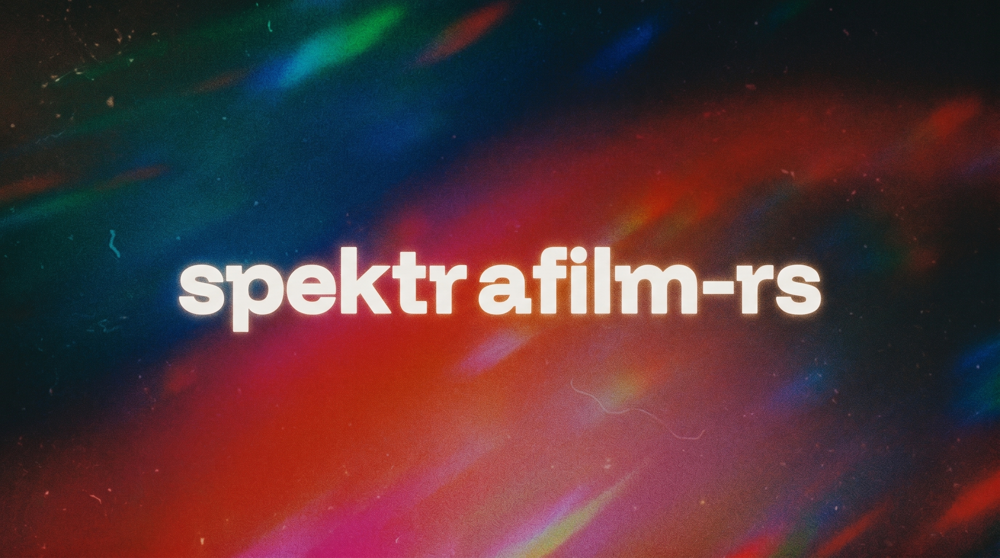

# spektrafilm-rs

[English](README.md) | **简体中文**

基于 Rust 的物理胶片、印相与扫描模拟引擎，支持光谱处理和 GPU 加速。
项目基于 [turbasvin](https://github.com/turbasvin/spektrafilm-rs) 对
[Andrea Volpato 的 spektrafilm](https://github.com/andreavolpato/spektrafilm) 的 Rust 移植。

开发由摄影应用 **FPW** 的需求驱动，FPW **暂未公开**。
胶片引擎在本仓库独立维护，可以独立构建和使用。

## 开发目标

- 在保留既有渲染效果的基础上，完善物理胶片处理流程。
- 将胶片算法与 GPU 资源管理集中在同一个引擎中，并提供明确的宿主接口文档。
- 通过可复现的对照验证数值与性能变化；对影响画面观感的变化进行版本管理。

## 功能

- 基于光谱的胶片曝光、显影、印相与扫描，内置胶片和相纸配置数据。
- 胶片光晕、DIR 成色剂、物理颗粒、眩光与光学效果。
- f32 GPU 处理，以及 f64 CPU 参考计算路径。
- 宿主提供的 GPU 设备、基于源图坐标的颗粒、有容量上限的缓存，以及 GPU / RGB16 / 区域输出。
- 独立命令行工具和图形预览界面。

## 快速开始

需要 Rust **1.99+** 及所在平台的原生构建工具。Vulkan 是目前经过验证的物理引擎 GPU 后端。
CI 覆盖 Windows 构建和 Linux 软件 Vulkan 计算；其他平台与后端组合需要单独验证。
原生依赖、图形界面与导出配置，以及实验性 CUDA 选项，见[构建与使用](docs/USAGE.md)。

```sh
git clone https://github.com/ye602a/spektrafilm-rs.git
cd spektrafilm-rs
cargo build --locked --release -p spektrafilm-cli --bin spektrafilm
./target/release/spektrafilm list-profiles --data-dir data
./target/release/spektrafilm process input.tif -o output.png \
    --film kodak_portra_400 --paper kodak_portra_endura --data-dir data
```

Windows 下请使用 `target\release\spektrafilm.exe`，并将处理命令写在同一行。

## 文档

- [构建与使用](docs/USAGE.md)
- [宿主 GPU 接入](docs/maintenance/HOST_GPU_INTEGRATION_CONTRACT.md)
- [公开接入示例](crates/spektrafilm-core/examples/fpw_host_contract.rs)
- [兼容性与开发计划](docs/maintenance/FPW_PARITY_MIGRATION_PLAN.md)
- [验证范围与依据](docs/maintenance/VALIDATION.md)

## 致谢与许可

最初的 Rust 实现由 [turbasvin](https://github.com/turbasvin/spektrafilm-rs) 完成。
胶片模型、光谱与配置数据来源于
[Andrea Volpato 的 spektrafilm](https://github.com/andreavolpato/spektrafilm)。
光谱升采样基于 [Johannes Hanatos](https://github.com/hanatos) 的工作。
数值计算实现参考了 NumPy、SciPy、scikit-image 和 colour-science；
[多层颗粒与高精度 IIR 的来源说明](docs/maintenance/GRAIN_MULTILAYER_MIGRATION.md)
包含 SpektraLab 的贡献。

代码采用 [GPL-3.0](LICENSE) 许可。光谱数据、配置数据及其衍生内容适用
[上游署名与 CC BY-SA 4.0 条款](SPEKTRAFILM_DATA_LICENSE.txt)。
[版本化校准数据的来源记录](data/negative_scan_ap0_v1/PROVENANCE.md)与数据一同保留。
